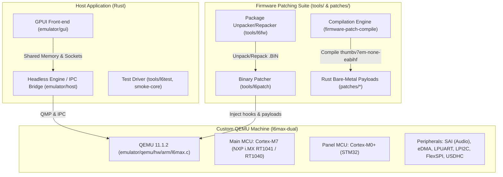
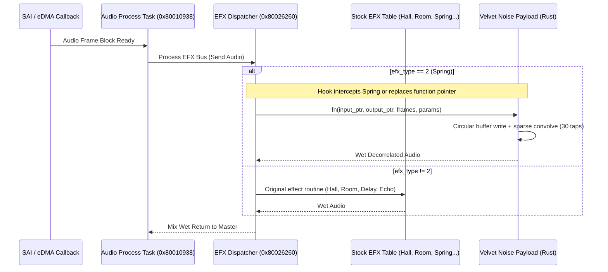

# Zoom L6 / L6max Codebase Review & Velvet Noise Decorrelator Feasibility Analysis

This report evaluates the **zoom-l6max** repository architecture and examines the technical feasibility of porting the core algorithm from [115dkk/Velvet-Noise-Decorrelator-VST3](https://github.com/115dkk/Velvet-Noise-Decorrelator-VST3) to run on the Zoom LiveTrak L6 and L6max digital mixer hardware as an onboard effect replacing the built-in **Spring Reverb**.

---

## 1. Codebase Architecture Review

The [`zoom-l6max`](file:///home/vcarlson/zoom-l6max/README.md) repository is a clean-room reverse-engineering, emulation, and firmware-patching suite for the **Zoom LiveTrak L6** and **L6max** digital mixers and multi-track recorders.

### System Architecture Overview



### Key Subsystems

1. **Dual-MCU QEMU Board Model ([`emulator/qemu/hw/arm/l6max.c`](file:///home/vcarlson/zoom-l6max/emulator/qemu/hw/arm/l6max.c))**:
   - **Main Processor**: Confirmed on L6 as an **NXP i.MX RT1041** (600 MHz ARM Cortex-M7 with VFPv5 double-precision FPU, 32 KiB I/D cache, 1 MiB ITCM, 1 MiB DTCM, and 64 MiB SDRAM at `0x80200000`).
   - **Panel Processor**: STM32 Cortex-M0+ scanning switches, rotary encoders, and refreshing LED matrices.
   - **Inter-chip Link**: Bidirectional LPUART (LPUART7 on L6, LPUART1 on L6max) with framing protocol.
   - **Audio Subsystem**: NXP SAI (Serial Audio Interface) driving 48 kHz / 24-bit TDM/I2S channels, backed by eDMA with scatter-gather descriptors.

2. **Firmware Execution & OS**:
   - The Main MCU runs **FreeRTOS**.
   - Mixer tasks identified in [`tools/l6dbg/src/uart_startup.rs`](file:///home/vcarlson/zoom-l6max/tools/l6dbg/src/uart_startup.rs#L21-L53):
     - `l6_audio_process_task_entry` (`0x80010938`)
     - `audio_float_ip_task_entry` (`0x80010228`)
     - `audio_int_ip_task_entry` (`0x80010390`)
     - `audio_efx_queue_task_entry` (`0x80026260`)
     - `dsp_stream_callback` (`0x80066180` on L6max, `0x8004fa98` on L6)
   - Codec communication: LPI2C1 talks to multi-channel audio ADCs (e.g. TLV320ADC6140 at `0x4c`/`0x4d`).
   - > [!IMPORTANT]
     > All audio mixing, EQ, and effects (Hall, Room, Spring, Delay, Echo) are executed in **software on the ARM Cortex-M7**, not on a dedicated off-chip DSP.

3. **Firmware Patching Infrastructure ([`patches/`](file:///home/vcarlson/zoom-l6max/patches/README.md) & [`tools/l6patch`](file:///home/vcarlson/zoom-l6max/tools/l6patch/src/main.rs))**:
   - Payloads are written in **Rust** (`no_std`, `panic = "abort"`, target `thumbv7em-none-eabihf`).
   - Compiled by [`tools/firmware-patch-compile`](file:///home/vcarlson/zoom-l6max/tools/firmware-patch-compile/src/lib.rs) with `rustc` and `rust-lld`.
   - Placed in flash free space (`PAYLOAD_BASE = 0x80108000` on L6max, or aligned after the MAIN binary on L6).
   - Hooked via Thumb-2 branch veneers (`B.W` / `BL`) registered in `hooks.tsv`.
   - Existing production patches:
     - [`knob-dialog`](file:///home/vcarlson/zoom-l6max/patches/knob-dialog/README.md): Displays encoder adjustments via the stock popup notification system.
     - [`midi-sync`](file:///home/vcarlson/zoom-l6max/patches/midi-sync/README.md): CC-127 full mixer parameter dump.
     - [`din-mixer-control`](file:///home/vcarlson/zoom-l6max/patches/din-mixer-control/README.md): DIN MIDI IN mixer control forwarding.

4. **Settings & State ([`tools/l6nor`](file:///home/vcarlson/zoom-l6max/tools/l6nor/src/main.rs))**:
   - Manages non-volatile settings banks (scenes, mixer parameters, calibration).
   - Effects are defined as:
     - `mixer.current.efx_type`: `0`=Hall, `1`=Room, `2`=Spring, `3`=Delay, `4`=Echo, `5`=AI Noise Reduction.
     - `mixer.current.efx_param[10]`: Array of ten 16-bit values (two per effect). Spring reverb uses indices `4` and `5`.

---

## 2. Velvet Noise Decorrelator Algorithm Review

Based on source inspection of [`vnd-vst3/include/velvet/processor.h`](file:///home/vcarlson/.gemini/antigravity-cli/brain/16761fb6-bee0-440d-bd91-ff362c9ddee0/scratch/vnd-vst3/include/velvet/processor.h) and [`vnd-vst3/src/processor.cpp`](file:///home/vcarlson/.gemini/antigravity-cli/brain/16761fb6-bee0-440d-bd91-ff362c9ddee0/scratch/vnd-vst3/src/processor.cpp):

### Mathematical Formulation

The Velvet Noise Decorrelator (VND) passes audio through a sparse FIR filter whose impulse response is composed of randomly spaced positive and negative impulses (taps) enveloped by an exponential decay:

$$h(n) = \sum_{m=0}^{M-1} s_m \, A_m \, \delta(n - d_m)$$

Where:
- $M$: Number of taps (default $\approx 30$ taps at 48 kHz for a duration of $T = 27.56\text{ ms}$).
- $d_m$: Delay of the $m$-th impulse, partitioned on a grid $T_s = \frac{N}{M-1}$ with bounded random jitter:
  $$d_m = \text{round}\left(m \cdot T_s + U(-0.45, 0.45) \cdot T_s\right)$$
- $s_m \in \{+1, -1\}$: Pseudo-random sign generated by `splitMix64`.
- $A_m = 10^{\frac{\text{decayDb} \cdot (d_m / N)}{20}}$: Exponential decay envelope.
- Normalization: The entire kernel is scaled by $1 / \sqrt{\sum A_m^2}$ to preserve unit energy.

### Convolution Complexity

Because $h(n)$ is **sparse** (only $M \approx 30$ non-zero coefficients out of 1,324 samples):
$$\text{wet}(n) = \sum_{m=0}^{M-1} g_m \cdot x(n - d_m)$$

Evaluating one output sample requires **only 30 multiply-accumulate (MAC) operations per channel**.

### Dynamic Kernel Renewal

In `Dynamic` mode, independent sequences are assigned to each channel and renewed every `refreshSeconds` (default 5.0 s) using an equal-power crossfade over `transitionMs` (default 250 ms):
$$\text{wet}(n) = \cos\left(\frac{\pi k}{2 K}\right) \cdot \text{wet}_{\text{old}}(n) + \sin\left(\frac{\pi k}{2 K}\right) \cdot \text{wet}_{\text{new}}(n)$$
During crossfading (which lasts 250 ms every 5 s, or 5% of the time), computation doubles to 60 MACs per channel. In `Static` mode, crossfading is omitted.

---

## 3. Feasibility Assessment for Zoom L6 / L6max

| Evaluation Dimension | Requirement | L6 / L6max Capability | Feasibility Verdict |
| :--- | :--- | :--- | :--- |
| **CPU Processing** | 30–60 MACs/sample at 48 kHz | 600 MHz Cortex-M7 (single-cycle `VFMA.F32`) | **FEASIBLE (< 2% CPU load)** |
| **RAM Consumption** | 10–38 KiB delay buffer | 64 MiB SDRAM + 2 MiB SRAM + 1 MiB DTCM | **FEASIBLE** |
| **Flash / Code Footprint** | ~2–4 KiB compiled ARM code | > 600 KiB available payload flash | **FEASIBLE** |
| **Parameter Mapping** | 2 exposed parameters on Zoom L6 | Time Spread + Density/Decay or Tone | **FEASIBLE** |
| **UI & Controls** | Front panel EFX SEL & send knobs | Reuses "Spring" LED and existing send routing | **FEASIBLE** |
| **SysEx / Settings** | Compatibility with scenes and MIDI | Uses standard `efxParam` slots (indices 4, 5) | **FEASIBLE** |

### Detailed Analysis

#### 1. Processing Overhead
- Total stereo sample rate: $48,000 \times 2 = 96,000\text{ samples/sec}$.
- At 30 MACs/sample: $2.88\text{ million MACs/sec}$.
- During crossfade (60 MACs/sample): $5.76\text{ million MACs/sec}$.
- On a 600 MHz Cortex-M7 with dual-issue pipeline and single-cycle floating point FMA (`VFMA`), this consumes roughly **5.8 to 9.6 million clock cycles per second**, representing **~1.0% to 1.6% of single-core capacity**.
- Standard algorithmic spring reverb implementations (comb filters, allpass dispersion filters, non-linear saturation) typically consume 5% to 12% CPU. Replacing spring reverb with VND will actually **decrease overall CPU utilization**.

#### 2. Memory Footprint
- **Delay Buffer**:
  - Stereo 48 kHz buffer for 30 ms: $2 \times 1,440 \times 4\text{ bytes} \approx 11.5\text{ KiB}$.
  - Maximum buffer for 100 ms: $2 \times 4,800 \times 4\text{ bytes} \approx 38.4\text{ KiB}$.
- **Tap Storage**:
  - 2 banks $\times$ 2 channels $\times$ 32 taps $\times$ 8 bytes = 1,024 bytes.
- The i.MX RT1041 has 64 MiB of SDRAM (`0x80200000`) and 2 MiB of on-chip SRAM (`0x20000000`). Statically allocating 40 KiB is trivial.

#### 3. Parameter Mapping (2-Parameter Limitation)
On the L6 and L6max, each effect exposes **two 14-bit parameters**:
- In the factory Spring Reverb:
  - `Parameter 0`: Time / Reverb Decay (0–100, default 90).
  - `Parameter 1`: Tone / High Frequency Damping (0–100, default 30).
- Recommended mapping for the Velvet Noise Decorrelator:
  - **Knob 1 (Time / Spread)**:
    - Controls `lengthMs` (e.g. 10 ms to 80 ms).
    - Automatically scales `density` or tap count ($M \approx 15$ to 60) to maintain uniform decorrelation across the time window.
  - **Knob 2 (Damping / Tone or Density)**:
    - *Option A (High-frequency Damping)*: Standard 1-pole low-pass filter on the wet output ($\alpha = 0.1 \dots 1.0$). This preserves the tactile "Tone" behavior of the original Spring reverb knob.
    - *Option B (Decay / Coloration)*: Controls `decayDb` (-12 dB to -80 dB) or switches between static and dynamic mode.

---

## 4. Reverse-Engineering & Patch Integration Strategy



### Integration Steps

1. **Locating the EFX Dispatch Table**:
   - Trace callers of `MIXER_GET_EFX_TYPE` (`0x8000b270`) and inspect the task loop in `audio_efx_queue_task_entry` (`0x80026260`) and `dsp_stream_callback` (`0x80066180`).
   - Identify the dispatch table: typically an array of 5 function pointers:
     ```c
     typedef void (*efx_proc_fn)(float *in_l, float *in_r, float *out_l, float *out_r, uint32_t frames, void *state);
     ```
   - Identify the spring reverb function pointer (index 2).

2. **Developing the Rust Patch (`patches/velvet-decorrelator/`)**:
   - Write `payload.rs`:
     - `no_std` Rust implementation of the VND processor.
     - Fast single-precision floating point (`f32`) using `core::f32::math` or ARM intrinsics.
     - Fixed pre-allocated memory in `.bss` or `.data` located in SDRAM.
   - Trampoline hook:
     - Either overwrite the pointer at index 2 in the EFX function table, or place a branch veneer at the prologue of the spring reverb function.

3. **Building with `l6patch`**:
   - Add `patches/velvet-decorrelator` to [`tools/firmware-patch-core/src/lib.rs`](file:///home/vcarlson/zoom-l6max/tools/firmware-patch-core/src/lib.rs#L8-L11).
   - Generate `velvet-decorrelator.payload.bin` and hook edits in `hooks.tsv`.
   - Repack into `L6.BIN` or `L6max.bin` via `cargo run -p l6patch`.

---

## 5. Development Constraints & Testing Realities

> [!WARNING]
> ### Emulator Audio Limitation
> The QEMU emulator in this repository (`zoom-l6max`) currently models peripheral register traffic (SAI, eDMA, DMAMUX) and validates task callbacks, but **does not synthesize or stream full digital audio end-to-end**.
> 
> As noted in [`docs/emulator/audio.md`](file:///home/vcarlson/zoom-l6max/docs/emulator/audio.md) and [`README.md`](file:///home/vcarlson/zoom-l6max/README.md#what-you-can-do):
> > *"Audio processing and USB audio streaming are not implemented... Capture and physical jack routing remain open."*

### Validation Strategy

To develop and test this patch without relying on physical hardware initially:
1. **Host-Side Unit Tests (Rust)**:
   - Implement the VND core in a host crate with tests against known impulse responses and the reference C++ implementation from `115dkk/Velvet-Noise-Decorrelator-VST3`.
2. **CPU Simulator (`tests/cpu_sim.py`)**:
   - Execute the ARM Thumb-2 payload using Unicorn engine to verify register preservation, stack layout, and math stability.
3. **QEMU Stability Smoke Checks**:
   - Boot the patched image in QEMU (`cargo run -p l6test -- --case audio-path`).
   - Verify that the FreeRTOS audio task and `dsp_stream_callback` continue running without CPU faults, watchdog timeouts, or priority inversions.
4. **Physical Hardware Verification**:
   - Flash the patched update package onto an actual Zoom L6 or L6max SD card.
   - Listen to the Spring Reverb effect on an instrument or drum loop to verify the decorrelation / stereo widening effect in real time.

---

## 6. Summary & Recommendations

Porting the Velvet Noise Decorrelator to replace Spring Reverb is **highly feasible**:
- **Computational Fit**: It requires $<2\%$ of the Cortex-M7 CPU budget, easily fitting into the FreeRTOS audio stream callback.
- **Memory Fit**: Requires $\sim 15 - 40\text{ KiB}$ of buffer space, which is negligible in a system with 64 MiB SDRAM.
- **Architectural Fit**: It seamlessly maps to the mixer's 2-parameter structure and EFX send routing.
- **Tooling Compatibility**: The repository's `l6patch` and `firmware-patch-compile` infrastructure is already designed for bare-metal Rust payloads on Cortex-M7.

### Next Steps for Implementation
1. Decide whether the 2 exposed parameters should control **(Spread, Tone Damping)** or **(Spread, Density/Evolution)**.
2. Disassemble `main_firmware.bin` around `0x80026260` / `0x80066180` to extract the exact function signature and buffer calling convention of the Spring Reverb routine.
3. Scaffold `patches/velvet-decorrelator/` based on the existing `patches/midi-sync` and `patches/knob-dialog` templates.
