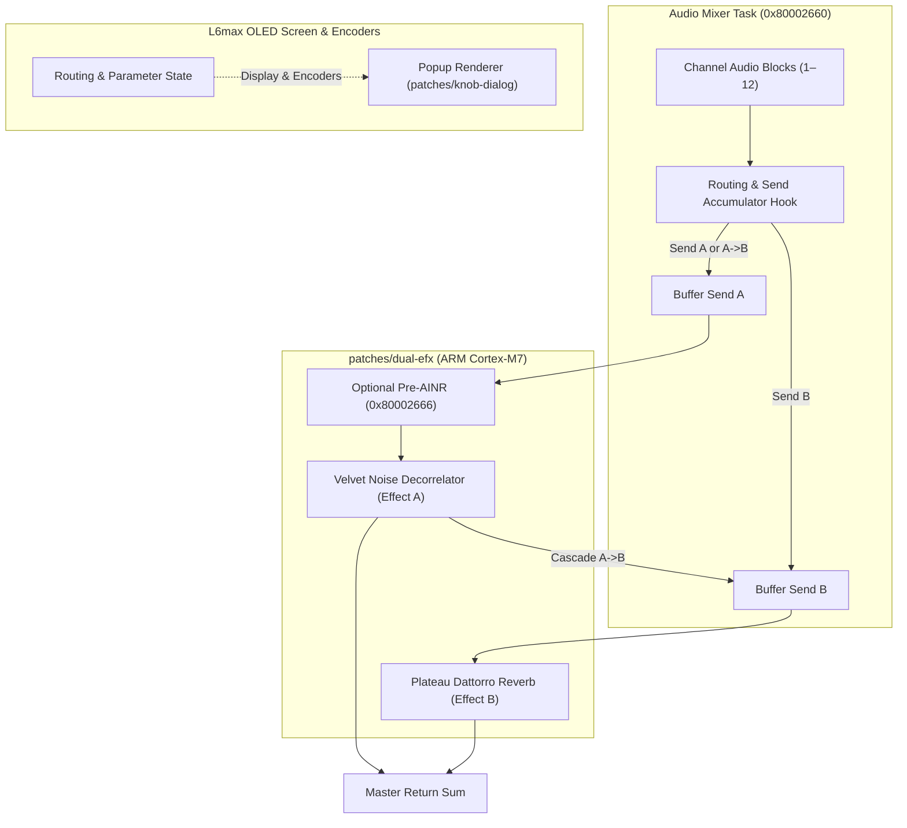

# Implementation Plan: Dual Custom Effects (Velvet Noise + Plateau) on Zoom LiveTrak L6max

This plan details the architecture and implementation steps to replace the stock Room and Spring reverbs on the **Zoom LiveTrak L6max** with high-end, custom DSP engines:
1. **Velvet Noise Decorrelator (VND)** (replacing Spring Reverb, `efx_type = 2`), based on [115dkk/Velvet-Noise-Decorrelator-VST3](https://github.com/115dkk/Velvet-Noise-Decorrelator-VST3).
2. **Plateau Reverb** (replacing Room Reverb, `efx_type = 1`), based on Dale Johnson's Dattorro plate reverb from [PlateauNEVersio](https://github.com/digitalartifactmusic/PlateauNEVersio).
3. **Dual Send Bus & Flexible Routing Matrix**: Allowing channels to send to `Neither`, `Effect A` (VND), `Effect B` (Plateau), or `Effect A → B` (VND cascaded into Plateau).
4. **Optional Pre-AINR (AI Noise Reduction)**: Running Zoom's stationary noise reduction ahead of the effects chain to prevent background noise amplification in reverb tails.
5. **Expanded Multi-Parameter Screen Controls**: Bypassing the stock 2-parameter limitation using the L6max OLED display and rotary encoders.

---

## User Review Required

> [!IMPORTANT]
> ### 1. Parameter Persistence & Scene Compatibility
> The factory NOR flash mixer scenes (`mixer.scene-0` through `mixer.scene-9`) only store **two 16-bit values** per effect slot (`efx_param[0..9]`).
> **Proposed Approach**:
> * We pack the two primary macro parameters (e.g. *Time Spread* and *Tone / Decay*) into the stock scene slots so that standard scene saving / recall works seamlessly.
> * Extended parameters (e.g. *Diffusion, Modulation Speed, Density, Evolution*) will be stored in an allocated configuration block within flash/SDRAM or default to studio-calibrated values unless modified in the current session.
> * Does this match your intended workflow?

> [!TIP]
> ### 2. Control Surface Mapping on L6max
> For controlling the full parameter set on the hardware:
> * **Default Mode**: When the blue `EFX` button is selected, the 8 channel encoders adjust the 8 channel send levels (as normal).
> * **Parameter Edit Mode**: Long-pressing (or double-tapping) `EFX SEL` opens the **Effect Parameter Inspector** on the OLED display:
>   - Channel Encoders 1–8 become dedicated parameter knobs for the active effect (e.g., Pre-delay, Size, Decay, Low Cut, High Cut, Diffusion, Modulation, Freeze).
>   - Any encoder turn triggers the stock notification popup renderer to display the live value and unit.

---

## Open Questions

1. **Routing Selector UI**:
   - Would you prefer setting a channel's routing (`Off`, `A`, `B`, `A → B`) via:
     - **Option A (Screen Popup)**: Turning a channel's `EFX` knob brings up the popup, and clicking the encoder or pressing `Up`/`Down` cycles the routing mode.
     - **Option B (Dedicated Menu)**: A clean sub-menu under `Menu → Effect Settings → Channel Routing` listing Channels 1–8.
2. **Freeze Button Behavior**:
   - For Plateau's infinite sustain **Freeze**:
     - Should it be a toggle (press to freeze, press to unfreeze), or a momentary hold (held down while active)?

---

## Proposed Changes



---

### Component 1: Core DSP Engines (`patches/dual-efx/src/`)

#### [NEW] `patches/dual-efx/src/math.rs`
- Standalone, `no_std`, allocation-free single-precision float math library.
- Fast `sin`, `cos`, `sqrt`, `pow10` (dB conversion), `exp2`, and `clamp`.
- Leverages Cortex-M7 hardware instructions (`vsqrt.f32`, `vfma.f32`).

#### [NEW] `patches/dual-efx/src/velvet.rs`
- Implementation of the **Velvet Noise Decorrelator**.
- 48 kHz circular delay line (up to 4,802 samples $\approx 100\text{ ms}$).
- 64-tap sparse impulse generator with deterministic `splitMix64` PRNG.
- Unit-energy normalization preserving volume across parameter shifts.
- Equal-power sinusoidal crossfade for click-free dynamic kernel renewals.

#### [NEW] `patches/dual-efx/src/plateau.rs`
- Implementation of the **Plateau (Dattorro Plate Reverb)** in pure `f32` Rust.
- 4 input diffuser allpass filters + pre-delay line (up to 12,000 samples $\approx 250\text{ ms}$).
- Modulated figure-eight tank loops with 4 triangle LFOs, damping one-pole filters, and cross-coupling decay.
- 14 output taps with 20 Hz DC-blocking highpass filters.
- Zero-decay **Infinite Freeze** mode.

#### [NEW] `patches/dual-efx/src/routing.rs`
- Multi-bus send accumulator supporting 4 modes per channel:
  - `Routing::Neither`: Channel does not send to effects.
  - `Routing::SendA`: Channel sends audio directly to Velvet Noise Decorrelator.
  - `Routing::SendB`: Channel sends audio directly to Plateau Reverb.
  - `Routing::SendAtoB`: Channel sends audio to VND, and VND's wet output cascades into Plateau.
- Optional pre-processor hook for Zoom's AI Noise Reduction (cleans signal before entering the decorrelator/reverb).

---

### Component 2: Hardware Control & OLED UI (`patches/dual-efx/src/`)

#### [NEW] `patches/dual-efx/src/parameters.rs`
- Defines the full parameter model for both effects:
  - VND: *Amount, Time Spread, Density, Decay, Refresh Rate, Transition Time, Mode*.
  - Plateau: *Pre-delay, Time Scale/Size, Decay, Low Cut, High Cut, Diffusion, Modulation, Freeze*.
- Formats text strings and units for display on the L6max 128×64 OLED screen (dB, ms, %, Hz/kHz).

#### [NEW] `patches/dual-efx/src/ui.rs`
- Intercepts encoder and navigation button inputs when editing effects.
- Integrates with the proven popup renderer from [`patches/knob-dialog`](file:///home/vcarlson/zoom-l6max/patches/knob-dialog/README.md) to draw parameter titles and values at centered coordinates (`Y=32`).

---

### Component 3: Firmware Hooks & Payload (`patches/dual-efx/`)

#### [NEW] `patches/dual-efx/src/payload.rs`
- Bare-metal entry point (`#![no_std]`, `#![no_main]`) compiled for `thumbv7em-none-eabihf`.
- Contains static memory buffers allocated in SDRAM/SRAM for delay lines and state.
- Dispatches effect processing calls when hooked by the mixer task.

#### [NEW] `patches/dual-efx/hooks.tsv`
- Records hook target addresses, displaced instruction lengths, and SHA-256 validation hashes for `main_firmware.bin` (SHA-256 `980d9227...`):
  - Hook 1: `0x80002666` (Effect dispatcher in audio mixer task).
  - Hook 2: `0x8000277c` (Effect parameter application call `0x80003c58`).
  - Hook 3: Encoder / Navigation key interceptor.

#### [NEW] `patches/dual-efx/linker/link.ld`
- Placement script positioning the compiled payload in erased flash at `PAYLOAD_BASE = 0x80108000`.

---

### Component 4: Build System & Workspace Integration

#### [MODIFY] `tools/firmware-patch-core/src/lib.rs`
- Add `"dual-efx"` to `PATCHES` array:
```diff
- pub const PATCHES: [&str; 3] = ["knob-dialog", "midi-sync", "din-mixer-control"];
+ pub const PATCHES: [&str; 4] = ["knob-dialog", "midi-sync", "din-mixer-control", "dual-efx"];
```

#### [NEW] `tools/l6dsp-tests/`
- Host test suite in `tools/` that imports `patches/dual-efx/src/` modules and tests:
  - Velvet Noise impulse response, energy conservation, and crossfade continuity.
  - Plateau tank stability, DC-offset rejection, and freeze loop sustain.
  - Routing accumulator logic with simulated multi-channel audio blocks.

---

## Verification Plan

### Automated Tests

1. **Host-Side DSP Unit Tests**:
   ```sh
   cargo test -p l6patch
   cargo test --package l6dsp-tests
   ```
   *Validates mathematical precision, bounds checks, zero-allocation behavior, and energy normalization.*

2. **Cortex-M7 Payload Compilation**:
   ```sh
   cargo run -p l6patch -- unpacked-l6max firmware-dual-efx-v113 --patch dual-efx
   ```
   *Validates that `rustc` successfully links the ARM Thumb binary, satisfies memory limits, and calculates correct checksums for `L6max.bin`.*

3. **QEMU Stability & Audio Callback Smoke Test**:
   ```sh
   cargo run -p l6test -- run --case audio-path --model l6max
   ```
   *Validates that the patched firmware boots under QEMU, FreeRTOS starts all audio tasks, and the audio stream callback executes without CPU faults or watchdog panics.*

### Manual Verification

1. **Firmware Update Flow**:
   - Copy the repacked `L6max.bin` to a microSD card.
   - Power on while holding `Play` to launch the Zoom update installer.
   - Verify successful flash verification and reboot into System Version `1.13` (or configured custom version).
2. **Onboard UI Navigation**:
   - Press `EFX SEL` to navigate to Room and Spring.
   - Long-press `EFX SEL` to open the parameter inspector.
   - Turn channel encoders 1–8 and confirm parameter popups appear on the OLED display.
3. **Audio Quality Verification**:
   - Connect an instrument or drum loop into Channel 1.
   - Test **Velvet Noise Decorrelator**: Verify stereo width expansion without comb filtering.
   - Test **Plateau Reverb**: Verify smooth decay, high-frequency damping, and test the **Freeze** function for infinite sustain.
   - Test **A → B Cascade**: Route Channel 1 to `A → B` and verify that the decorrelated stereo image washes into the lush plate reverb.
