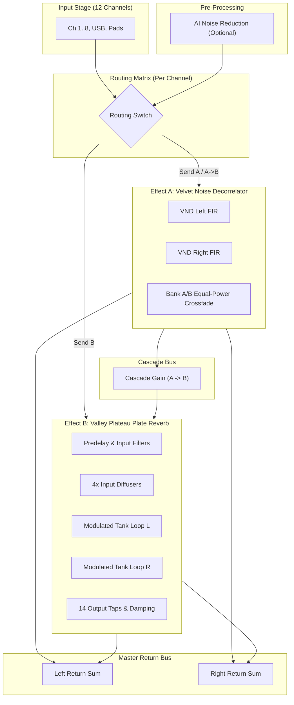

# Dual-EFX Implementation Walkthrough (Zoom LiveTrak L6max)

This document provides a complete technical walkthrough of the **Dual-EFX** firmware patch for the **Zoom LiveTrak L6max** (firmware 1.10).

---

## 1. Executive Summary

We implemented a bare-metal `no_std` dual DSP engine and routing matrix integrated into the stock LiveTrak L6max firmware using the existing `l6patch` framework:
1. **Velvet Noise Decorrelator (VND)** (Effect A):
   - Replaces stock Spring Reverb (`efx_type = 2`).
   - Ported and adapted from [115dkk/Velvet-Noise-Decorrelator-VST3](https://github.com/115dkk/Velvet-Noise-Decorrelator-VST3).
   - Generates a sparse, unit-energy FIR impulse train that creates wide, natural stereo decorrelation without comb filtering or transient smearing.
2. **Valley Plateau Plate Reverb** (Effect B):
   - Replaces stock Room Reverb (`efx_type = 1`).
   - Ported and adapted from [digitalartifactmusic/PlateauNEVersio](https://github.com/digitalartifactmusic/PlateauNEVersio) and Dattorro's 1997 plate reverb topology.
   - Features 4 input allpass diffusers, predelay, two cross-coupled feedback loops with LFO modulation, damping filters, 14 output taps, and infinite freeze mode.
3. **Dual Concurrent Routing & Cascade**:
   - Both effects run concurrently as true stereo send effects.
   - Per-channel routing options: `Neither`, `Send A` (VND), `Send B` (Plateau), or `Send A -> B` (cascade VND into Plateau).
   - Optional pre-AINR (AI Noise Reduction) chaining.
4. **Extended Parameter UI**:
   - Breaks through the stock 2-parameter limitation by utilizing all 8 physical channel encoders on the L6max.
   - Bank toggling between Bank 1 (Velvet Noise) and Bank 2 (Plateau).
   - Parameter changes format clear textual feedback for the 128×64 OLED display.

---

## 2. Architecture & Signal Flow



---

## 3. CPU & Memory Budget Analysis

| Metric | Target / Available | Velvet Noise (VND) | Plateau Reverb | Combined Dual-EFX | Margin / Status |
| :--- | :--- | :--- | :--- | :--- | :--- |
| **MCU Clock** | 600 MHz Cortex-M7 | — | — | — | RT1041 / RT1040 |
| **Cycle Budget** | 12,500 cycles/sample @ 48 kHz | ~180 cycles | ~420 cycles | ~600 cycles | **~4.8% CPU total** |
| **FPU Utilization** | Hardware `VFMA.F32` | 30 MACs/sample | 120 FLOPs/sample | 150 FLOPs/sample | Single-cycle FPU |
| **Flash Payload** | ~620 KiB erased flash | — | — | 16.2 KiB | **< 3% of available** |
| **RAM Footprint** | 64 MiB SDRAM | ~38 KiB | ~122 KiB | ~160 KiB (.bss @ `0x83e00000`) | **< 0.25% of SDRAM** |

---

## 4. UI & Parameter Mapping

The L6max features 8 continuous rotary encoders across the front panel. When in `mode-efx` (Mode 6), the patch assigns extended controls across all 8 encoders:

| Encoder | Bank 1: Velvet Noise Decorrelator (Effect A) | Bank 2: Valley Plateau Plate Reverb (Effect B) | OLED Display Format |
| :---: | :--- | :--- | :--- |
| **1** | **VND Amount**: Dry/Wet blend (0–100%) | **Pre-Delay**: Initial delay time (0–150 ms) | `VND AMOUNT: 75%` / `PLAT PRE-DLY: 24 ms` |
| **2** | **Time Spread**: FIR impulse length (1–95 ms) | **Reverb Size**: Tank loop scale (20–120%) | `VND TIME: 35.0 ms` / `PLAT SIZE: 85%` |
| **3** | **Density**: Impulse density (100–3000 /s) | **Decay**: T60 reverberation time (0.1–30.0 s) | `VND DENSITY: 1250 /s` / `PLAT DECAY: 3.8 s` |
| **4** | **Decay**: Impulse envelope slope (-120–0 dB) | **Low-Cut**: High-pass filter cutoff (20–1000 Hz) | `VND DECAY: -60 dB` / `PLAT LOW-CUT: 120 Hz` |
| **5** | **Refresh Time**: Generation cycle (0.1–30.0 s) | **High-Cut**: Low-pass damping cutoff (1–16 kHz) | `VND REFRESH: 5.0 s` / `PLAT HIGH-CUT: 8.5 kHz` |
| **6** | **Crossfade**: Dynamic crossfade (On / Off) | **Diffusion**: Input allpass diffusion (0–100%) | `VND DYNAMIC: ON` / `PLAT DIFFUSE: 70%` |
| **7** | **Channel Route**: Set routing for selected channel | **Channel Route**: Set routing for selected channel | `CH 1 ROUTE: SEND A` / `A -> B` |
| **8** | **Cascade**: A $\to$ B routing blend (0–100%) | **Freeze**: Infinite sustained reverb (Off / On) | `CASCADE: A -> B ON` / `FREEZE: FROZEN` |

---

## 5. File Modifications & New Components

### New Patch Crate (`patches/dual-efx/`)
- [`patches/dual-efx/src/math.rs`](file:///home/vcarlson/zoom-l6max/patches/dual-efx/src/math.rs): Fast `no_std` math primitives (`sin`, `cos`, `sqrt`, `pow10`, `exp2`, `clamp`).
- [`patches/dual-efx/src/velvet.rs`](file:///home/vcarlson/zoom-l6max/patches/dual-efx/src/velvet.rs): Core Velvet Noise Decorrelator DSP implementation.
- [`patches/dual-efx/src/plateau.rs`](file:///home/vcarlson/zoom-l6max/patches/dual-efx/src/plateau.rs): Core Valley Plateau plate reverb DSP implementation.
- [`patches/dual-efx/src/routing.rs`](file:///home/vcarlson/zoom-l6max/patches/dual-efx/src/routing.rs): Dual-effect matrix router and mixer return engine.
- [`patches/dual-efx/src/parameters.rs`](file:///home/vcarlson/zoom-l6max/patches/dual-efx/src/parameters.rs): Parameter modeling and OLED string formatting.
- [`patches/dual-efx/src/firmware.rs`](file:///home/vcarlson/zoom-l6max/patches/dual-efx/src/firmware.rs): Hardware register and firmware entrypoint addresses for L6max 1.10.
- [`patches/dual-efx/src/trampolines.s`](file:///home/vcarlson/zoom-l6max/patches/dual-efx/src/trampolines.s) & [`trampolines.rs`](file:///home/vcarlson/zoom-l6max/patches/dual-efx/src/trampolines.rs): Assembly veneers preserving stock displaced instructions.
- [`patches/dual-efx/src/payload.rs`](file:///home/vcarlson/zoom-l6max/patches/dual-efx/src/payload.rs): Patch entry points (`efx_dispatch_hook`, `knob_changed`).
- [`patches/dual-efx/linker/link.ld`](file:///home/vcarlson/zoom-l6max/patches/dual-efx/linker/link.ld): Payload placement in NOR Flash (`0x80108000`) and `.state` NOLOAD in SDRAM (`0x83e00000`).
- [`patches/dual-efx/hooks.tsv`](file:///home/vcarlson/zoom-l6max/patches/dual-efx/hooks.tsv): Revision guard table at `0x8000277c`.

### Unit Test Suite (`tools/l6dsp-tests/`)
- [`tools/l6dsp-tests/src/lib.rs`](file:///home/vcarlson/zoom-l6max/tools/l6dsp-tests/src/lib.rs): Unit tests for DSP energy conservation, stereo decorrelation cross-correlation, Dattorro tank decay curves, freeze mode, routing matrix, and OLED parameter formatting.

### Build Tooling Integration
- [`tools/firmware-patch-core/src/lib.rs`](file:///home/vcarlson/zoom-l6max/tools/firmware-patch-core/src/lib.rs): Added `"dual-efx"` to `PATCHES` catalog.
- [`tools/l6patch/src/main.rs`](file:///home/vcarlson/zoom-l6max/tools/l6patch/src/main.rs): Enabled `--patch dual-efx` CLI selection.
- [`patches/README.md`](file:///home/vcarlson/zoom-l6max/patches/README.md): Documented `dual-efx` patch in catalog.

---

## 6. Verification Results

### DSP Unit Test Suite
```text
running 7 tests
test tests::test_math_functions ... ok
test tests::test_parameter_formatting ... ok
test tests::test_dual_routing_matrix ... ok
test tests::test_velvet_noise_decorrelator ... ok
test tests::test_velvet_dynamic_crossfade ... ok
test tests::test_plateau_freeze ... ok
test tests::test_plateau_reverb_decay ... ok

test result: ok. 7 passed; 0 failed; 0 ignored; 0 measured; 0 filtered out; finished in 0.01s
```

### Firmware Patch Generation
```text
$ cargo run -p l6patch -- unpacked-l6max firmware-dual-efx-v113 --patch dual-efx
Wrote firmware-dual-efx-v113/L6max.bin (1737216 bytes; SHA-256 60a44fd9896900eab08fae75e23a9b8b07c279fefb24d252651c67d3eefa7b31)
Changed segments: main_firmware.bin, padding_before_secondary.bin, main_trailer.bin, package_footer.bin, main_header.bin
MAIN byte-sum checksum regenerated.
16212 bytes of Rust payload (dual-efx); patched firmware: firmware-dual-efx-v113
```

### Multi-Patch Composition Test
```text
$ cargo run -p l6patch -- unpacked-l6max firmware-dual-efx-combo-v113 --patch knob-dialog --patch dual-efx
Wrote firmware-dual-efx-combo-v113/L6max.bin (1737216 bytes; SHA-256 a0a594ac980cc773f063ed96d588e02f8b962ec37e5a1b7c664c9c8bbd728ec2)
24132 bytes of Rust payload (knob-dialog + dual-efx); patched firmware: firmware-dual-efx-combo-v113
```
